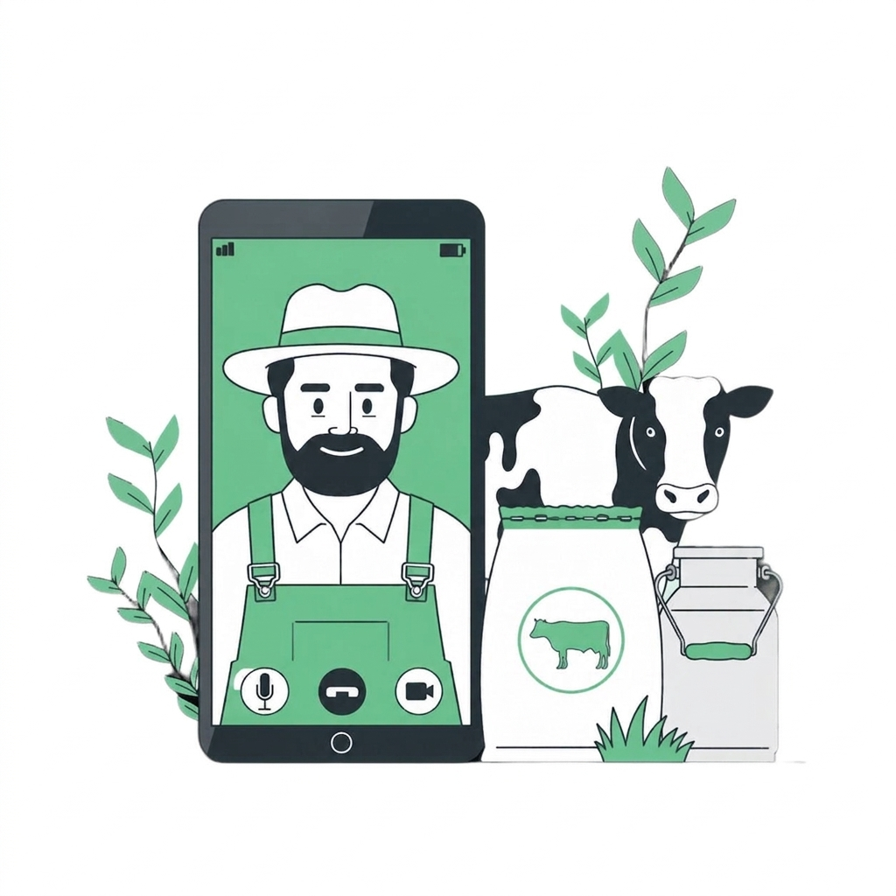

# Vantara Website

Landing page de **Hatarium**, la plataforma SaaS de gestión ganadera de Vantara.

## Estructura

```
index.html                  Página única (español + inglés)
assets/
  styles.css                Estilos
  script.js                 Menú móvil y header
  i18n/
    translations.js         Diccionarios de traducción (es / en)
    i18n.js                 Motor de cambio de idioma
  images/                   Imágenes
```

## Internacionalización (i18n)

La página es **una sola**. El botón `EN` / `ES` del menú cambia todo el contenido en vivo,
sin recargar ni navegar a otra página.

- La preferencia se guarda en `localStorage` (`hatarium-lang`), así que se mantiene al recargar.
- También se puede forzar el idioma con la URL: `index.html?lang=en` o `index.html?lang=es`.
- Se actualizan el `<html lang>`, el `<title>`, la meta descripción, los `alt` de las imágenes
  y los textos accesibles.

### Cómo agregar o editar textos

1. Abre `assets/i18n/translations.js` y agrega la clave en **todos** los idiomas (`es` y `en`).
2. En el HTML marca el elemento con el atributo correspondiente:

| Atributo | Uso |
| --- | --- |
| `data-i18n="clave"` | Reemplaza el texto del elemento |
| `data-i18n-html="clave"` | Reemplaza el HTML (permite `<span>`, por ejemplo en los títulos) |
| `data-i18n-attr="alt:clave"` | Reemplaza atributos (`alt`, `title`, `aria-label`…). Se separan con comas |
| `data-i18n-list="clave"` | Reconstruye los `<li>` de una lista a partir de un arreglo |

Ejemplo:

```html
<h3 data-i18n="about.commitment">Compromiso</h3>

<ul data-i18n-list="plans.basic.features">
    <li>Hasta 50 animales</li>
</ul>
```

### Agregar un idioma nuevo

1. Copia el bloque de `en` en `translations.js` y traduce los valores.
2. Agrega su código a `SUPPORTED_LANGS` en `assets/i18n/i18n.js`.

El botón alterna entre español e inglés; si agregas más idiomas, conviene reemplazarlo por un
selector (`<select>`).

## Uso local

Al ser HTML/CSS/JS estático no necesita build. Puedes abrir `index.html` directamente, aunque
para probar `?lang=` se recomienda un servidor local:

```bash
python -m http.server 8000
```

Luego visita `http://localhost:8000`.
